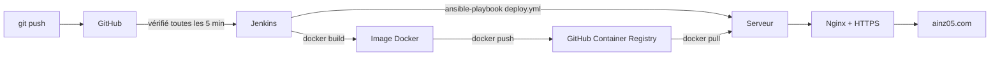

# Portfolio de Florian

Mon portfolio personnel, en ligne sur **[ainz05.com](https://ainz05.com)**.

C'est un site statique en React et TypeScript (VibeCodé avec l'aide d'agents Claude). Le but étant de développer mes compétences DevOps, j'ai monté la chaîne qui le met en ligne : image Docker, pipeline Jenkins, déploiement avec Ansible, DNS géré avec Terraform et HTTPS avec Let's Encrypt. Ce dépôt contient donc à la fois le site et son infrastructure. Il est hébergé sur un VPS OVH.

## Ce qu'il y a dans ce dépôt

| Dossier | Contenu |
|---|---|
| [`frontend/`](frontend/) | Le site : React 19, TypeScript, Vite, testé avec Vitest |
| [`ansible/`](ansible/) | Préparation du serveur (`provision.yml`) et déploiement du site (`deploy.yml`) |
| [`terraform/`](terraform/) | Enregistrements DNS du domaine chez OVH |
| [`jenkins/`](jenkins/) | Le serveur Jenkins, lancé avec Docker Compose |
| [`Jenkinsfile`](Jenkinsfile) | Le pipeline : construction, publication et déploiement |
| [`docs/`](docs/) | Maquette de référence et en-têtes de sécurité attendus |
| [`SPEC.md`](SPEC.md) | Contenu du site et règles de design |

## Comment le site est mis en ligne



1. **Jenkins** vérifie le dépôt toutes les 5 minutes. Quand il trouve un nouveau commit, il lance le pipeline.
2. Il **construit l'image Docker** du site en deux étapes : Node compile le site, puis seul le résultat est copié dans une image Nginx légère.
3. Il **publie l'image** sur `ghcr.io/ainz05/portfolio`, avec deux étiquettes : le hash court du commit et `latest`.
4. Il **déploie avec Ansible** : connexion SSH au serveur avec un utilisateur dédié, téléchargement de la nouvelle image, redémarrage du conteneur, puis vérification que le site répond.
5. Sur le serveur, le conteneur n'écoute que sur `127.0.0.1:8080`. C'est **Nginx** qui reçoit le trafic public, gère le certificat HTTPS et redirige HTTP vers HTTPS.

Chaque déploiement correspond donc à un commit précis, ce qui permet de revenir à une ancienne version en redéployant son étiquette.

## Lancer le site en local

Il faut Node.js 24.

```bash
cd frontend
npm ci
npm run dev
```

Autres commandes utiles :

| Commande | Rôle |
|---|---|
| `npm run build` | Construit le site dans `frontend/dist/` |
| `npm run preview` | Sert la version construite en local |
| `npm test` | Lance les tests |
| `npm run check` | Lance tous les contrôles : lint, types, architecture, tests et build |

Avec Docker :

```bash
docker build -t portfolio frontend
docker run --rm -p 8080:80 portfolio
```

Le site est alors sur http://localhost:8080.

## Le site

- **Statique, sans backend.** Le contact passe par un lien `mailto:`, sans formulaire.
- **Code organisé en couches** (`types` → `lib` → `ui` / `hooks` → `components` → `sections` → `app`). Une couche n'importe que les couches en dessous d'elle, et `dependency-cruiser` le vérifie à chaque `npm run check`.
- **Contenu séparé du code.** Tous les textes sont dans `frontend/src/data/` : pour changer un texte, on ne touche pas aux composants.
- **Accessible.** Le site vise le niveau WCAG 2.2 AA, et chaque composant est testé avec `axe`.
- **Sans ressource tierce.** Pas de CDN, pas de police distante, pas d'analytics. Tout est servi depuis le même domaine, ce qui permet une politique de sécurité de contenu (CSP) stricte.

Le détail des règles est dans [`frontend/CLAUDE.md`](frontend/CLAUDE.md).

## Infrastructure

### Préparer le serveur

`ansible/provision.yml` prépare un serveur Debian :

- pare-feu **UFW** : seuls les ports 22, 80 et 443 sont ouverts ; Il faudrait en principe que je change le port 22 pour la sécurité.
- **fail2ban** pour bloquer les attaques par force brute sur SSH ;
- **Docker Engine** ;
- un utilisateur `deploy` sans mot de passe, accessible uniquement avec la clé SSH de Jenkins ;
- **Nginx** en reverse proxy, avec des en-têtes de sécurité ;
- un certificat **Let's Encrypt** obtenu avec certbot, et Nginx rechargé à chaque renouvellement.

```bash
cd ansible
cp inventory.example.ini inventory.ini   # puis remplir l'IP, l'utilisateur et la clé
ansible-playbook provision.yml
```

Le playbook peut être relancé sans risque : il ne refait que ce qui manque.

### Gérer le DNS

`terraform/` crée les deux enregistrements `A` du domaine chez OVH : le domaine nu et `www`. Les accès à l'API OVH sont lus dans les variables d'environnement `OVH_APPLICATION_KEY`, `OVH_APPLICATION_SECRET` et `OVH_CONSUMER_KEY`, et ne sont jamais écrits dans le dépôt.

```bash
cd terraform
terraform init
terraform plan
terraform apply
```

### Lancer Jenkins

```bash
cd jenkins
docker compose up -d
```

Jenkins est alors accessible sur http://127.0.0.1:8081, uniquement depuis la machine locale. Il ne lance pas Docker directement sur la machine : il passe par un démon Docker séparé (Docker-in-Docker), pour que les constructions restent isolées.

Le pipeline a besoin de deux identifiants, à créer dans Jenkins :

| ID | Type | Contenu |
|---|---|---|
| `ghcr-push` | Nom d'utilisateur + mot de passe | Compte GitHub et jeton autorisé à publier des paquets |
| `deploy-ssh-b64` | Texte secret | Clé SSH privée de déploiement, encodée en base64 |

## Sécurité

- Aucun secret dans le dépôt : les jetons et les clés privées sont dans les identifiants de Jenkins ou dans des variables d'environnement. Le `.gitignore` exclut les fichiers d'état Terraform, les inventaires et les clés.
- La clé de déploiement n'existe que le temps du déploiement, dans un fichier temporaire supprimé à la fin.
- Le serveur vérifie l'empreinte SSH de l'hôte (`known_hosts`), au lieu de faire confiance à la première connexion.
- Les en-têtes HTTP attendus (CSP, HSTS…) sont décrits dans [`docs/DEPLOY-SECURITY.md`](docs/DEPLOY-SECURITY.md).

## Méthode de travail

Le code du site est écrit avec l'aide de Claude Code, avec trois agents aux rôles séparés : un qui écrit le code, un qui relit chaque diff avant le commit, et un qui audite la sécurité. Aucun commit ne passe sans relecture. Les règles sont dans [`CLAUDE.md`](CLAUDE.md), et les messages de commit suivent la convention [Conventional Commits](https://www.conventionalcommits.org/fr/). La partie déploiement avec Ansible, Terraform et Jenkins n'a pas été fait avec l'aide de ces agents.
